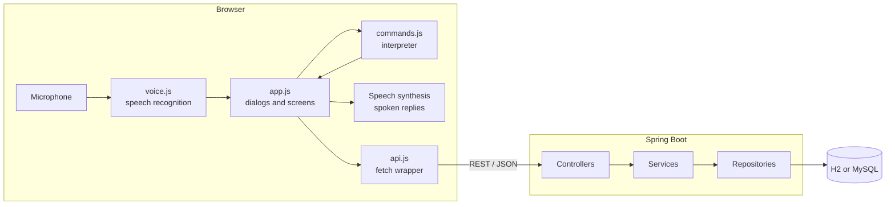
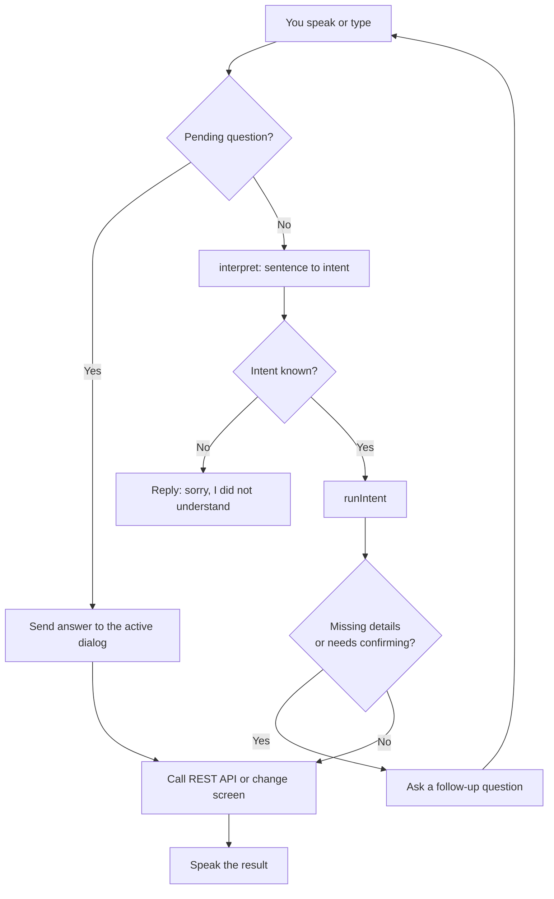
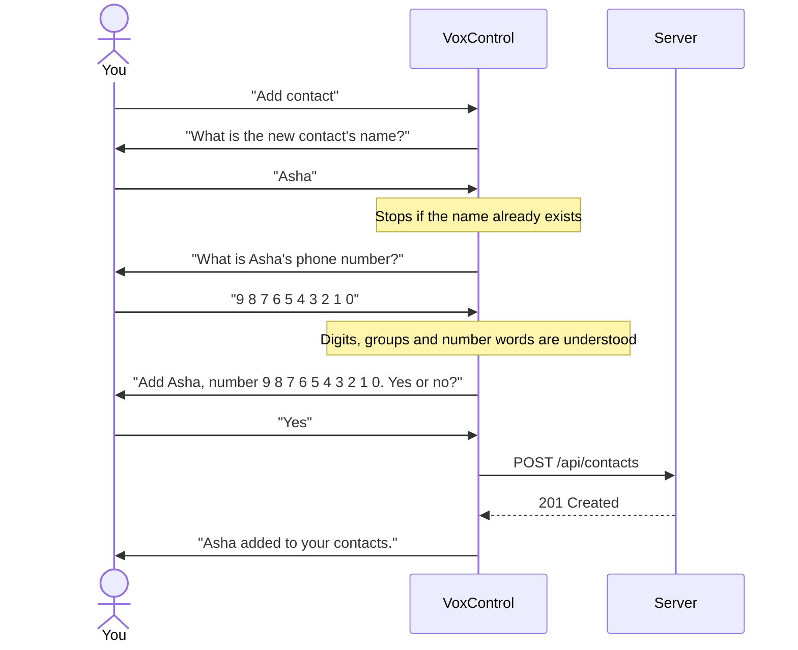
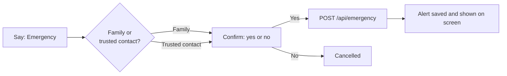

# VoxControl

A hands-free, voice-controlled phone interface that runs in the browser. Talk to it to open messages, call and text contacts, add contacts and reminders, and raise emergency alerts, all without touching the screen.

Built with a **Spring Boot 4** backend and a **dependency-free ES-module frontend** (no build step, no npm install).

> Calls and emergency alerts are simulated. Nothing is dialed or sent outside the app.

## Features

- **Continuous voice mode** using the browser's Web Speech API, with spoken replies
- **Messages**: read conversations, dictate and send messages, delete messages
- **Contacts**: browse, edit and delete, or add a new contact entirely by voice
- **Reminders**: add by voice ("remind me to take medicine at 8 pm"), complete, delete
- **Emergency**: alert family or a trusted contact, with a voice confirmation step
- **Guided dialogs**: if you leave something out, it asks a follow-up question and confirms before anything is saved or sent
- **Forgiving matching**: aliases ("mum", "papa") and small mis-hearings ("priyaa") still resolve to the right contact
- **Typed fallback**: browsers without speech recognition can type the same commands on the home screen

## Tech stack

| Layer | Technology |
|---|---|
| Backend | Java 21, Spring Boot 4.1, Spring Data JPA, Bean Validation |
| Database | H2 (file, default) or MySQL |
| Frontend | Vanilla JavaScript (ES modules), HTML, CSS, served as static files |
| Voice | Web Speech API (`SpeechRecognition` and `SpeechSynthesis`) |

## How it works

### Architecture



### From speech to action

Every utterance, spoken or typed, goes through the same path. If a question is pending, the answer goes to that dialog. Otherwise the interpreter turns the sentence into an intent.



### Adding a contact by voice



If you include the name or number in the first sentence, those steps are skipped. Saying "no" or "cancel" at any point stops without saving.

### Emergency flow



## Getting started

**Requirements:** JDK 21. Maven is included through the wrapper.

```bash
./mvnw spring-boot:run
```

Open <http://localhost:8080>. Use **Chrome or Edge** for voice input (it needs an internet connection and microphone permission).

The default H2 database is stored in `./data`, so there is nothing to install. Demo contacts, chats and reminders are added on first start; set `voxcontrol.seed-demo-data=false` to disable that.

### Using MySQL

```bash
DB_URL=jdbc:mysql://localhost:3306/touchless_db \
DB_USER=root \
DB_PASSWORD=your-password \
./mvnw spring-boot:run -Dspring-boot.run.profiles=mysql
```

The server port can be changed with the `PORT` environment variable (default `8080`).

## Voice commands

Say **"What can I say?"** in the app to see this list on screen.

| Goal | Examples |
|---|---|
| Navigate | "Open messages", "Open contacts", "Open reminders", "Go home", "Go back" |
| Call | "Call Mom", "End call" |
| Message | "Send message to Rahul", "Tell Dad I'm on my way", "Delete last message" |
| Open a person | "Open Priya's contact", "Open Rahul chat" |
| Add a contact | "Add contact", "Add Asha to my contacts", "Save contact called Asha 98765 43210" |
| Reminders | "Remind me to take medicine at 8 pm", "Complete take medicine", "Delete reminder buy milk" |
| Emergency | "Emergency", "Alert family", "Alert trusted contact" |
| Control | "Stop listening", "Cancel" |

**Adding a contact by voice:** anything you include in the sentence is used and the rest is asked for. Phone numbers can be spoken as digits ("9 8 7 6 5 4 3 2 1 0"), grouped ("98765 43210"), or as words ("nine eight seven…", "double four", "plus nine one…"). It reads the number back and saves only after you say yes.

For debugging, `voxcontrol.run('open messages')` in the browser console behaves as if you had said it.

## REST API

| Method and path | Notes |
|---|---|
| `GET` `POST` `/api/contacts` | Names are unique (409 on duplicates); phone is validated |
| `GET` `PUT` `DELETE` `/api/contacts/{id}` | |
| `GET /api/messages?contact=Rahul` | One conversation; omit `contact` for all messages |
| `GET /api/messages/conversations` | Inbox: every contact with their latest message |
| `POST /api/messages` | Contact must exist (404); text is 1-1000 characters |
| `DELETE /api/messages/{id}` | |
| `GET` `POST` `/api/reminders` | Open reminders are sorted first |
| `PUT /api/reminders/{id}/complete?completed=true` | |
| `DELETE /api/reminders/{id}` | |
| `POST /api/emergency` | Body: `{"type": "FAMILY"}` or `{"type": "TRUSTED_CONTACT"}` |
| `GET /api/emergency` | Alert history |

Errors are returned as RFC 9457 problem-detail JSON: `{ "status", "title", "detail", "errors": { "field": "message" } }`.

## Project structure

```
src/main/java/com/touchless/touchless/
  controller/   REST endpoints
  service/      business rules (uniqueness, validation, lookups)
  entity/       JPA entities
  dto/          request and response records
  repository/   Spring Data repositories
  exception/    error handling (problem-detail responses)
  config/       demo data seeder
src/main/resources/static/
  index.html
  css/style.css
  js/
    commands.js   voice-command interpreter (pure functions, no DOM or network)
    voice.js      speech recognition and speech synthesis
    app.js        screens, voice dialogs and event handling
    api.js        fetch wrapper for the REST API
    ui.js         small UI helpers (modal, toast, avatar)
src/test/
  java/         REST API integration tests
  js/           voice-command interpreter tests
```

The interpreter in `commands.js` turns a sentence into an intent such as `{ type: 'call', contact: 'Mom' }`. `app.js` executes the intent and runs any follow-up questions, so new commands usually mean one new pattern in `commands.js` and one new `case` in `runIntent`.

## Tests

```bash
./mvnw test                          # REST API integration tests (H2 in memory)
node src/test/js/commands.test.mjs   # voice-command interpreter (Node 18+)
```

## Browser support

| Browser | Voice input | Typed commands |
|---|---|---|
| Chrome, Edge | Yes | Yes |
| Firefox, Safari | Limited or no speech recognition | Yes |

## Roadmap ideas

- Spelling out unusual contact names by voice
- Editing and deleting contacts by voice
- Real calling and SMS integration
- Additional languages (the speech language is set in `voice.js`)
